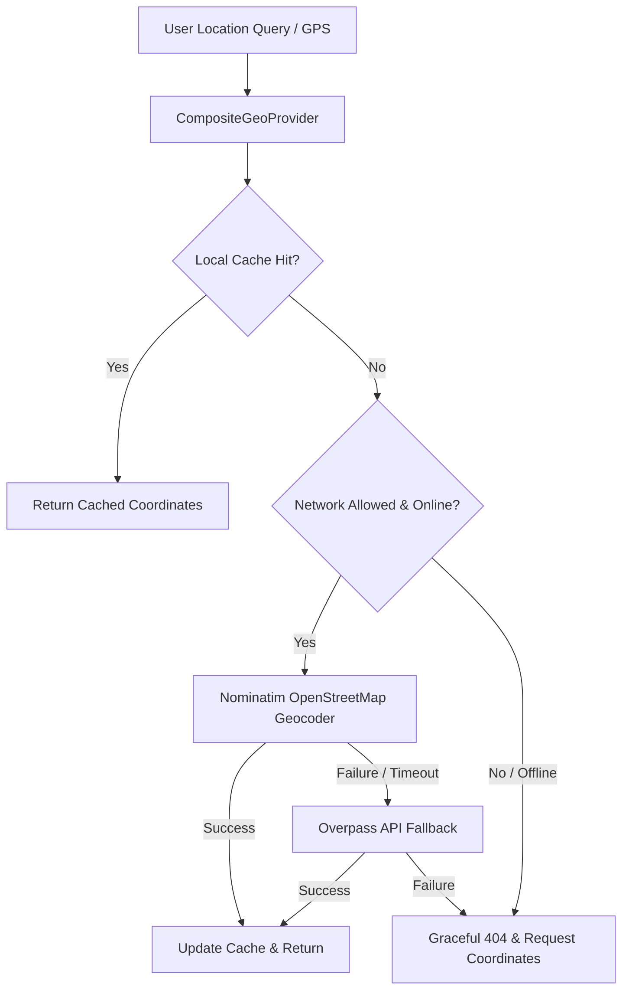

# Doctor, Clinic & Hospital Discovery and Provider Verification Architecture

## 1. Overview and System Purpose
Phase 3 of the ClintelAI platform establishes a trusted, location-aware healthcare discovery service across India. It connects users with verified medical specialists, clinics, and hospitals without making clinical diagnoses, recommending providers as medically superior, or fabricating credentials.

The core principle governing provider discovery is **"Discovery ≠ Endorsement"**. All providers are presented factually with transparent provenance, official council registration metadata, and clear verification tier badges.

---

## 2. Database Schema & Migrations

### 2.1 Database Technologies
- **Database Engine**: PostgreSQL 16
- **Spatial Extension**: PostGIS 3.4
- **ORM / Toolkit**: SQLAlchemy 2.0 (AsyncIO) + GeoAlchemy2
- **Migration Version**: `5715e8c21ca8_create_provider_discovery_and_verification_tables`

### 2.2 Table Definitions

#### `facilities`
Stores hospital, clinic, dispensary, and urban primary health centre entities with precise geographic coordinates.
- `id` (UUID, Primary Key)
- `name` (VARCHAR 255, Indexed)
- `facility_type` (ENUM: `hospital`, `clinic`, `health_center`, `dispensary`)
- `address_line1`, `address_line2`, `locality`, `city`, `state`, `pincode`, `country`
- `geom` (`Geometry(POINT, 4326)` with GIST spatial index)
- `phone`, `emergency_phone`, `email`, `website`
- `operating_hours` (JSONB)
- `emergency_services_available` (BOOLEAN)
- `verification_status` (ENUM: `VERIFIED`, `PARTIALLY_VERIFIED`, `UNVERIFIED`, `DEMO_SIMULATED`)
- `verification_tier` (VARCHAR 50)
- `verification_source`, `verification_method`, `verified_at`
- `is_demo_data` (BOOLEAN, default `TRUE`)
- `source_name`, `source_url`
- `created_at`, `updated_at`

#### `doctors`
Stores registered medical practitioners and specialists.
- `id` (UUID, Primary Key)
- `full_name` (VARCHAR 255, Indexed)
- `gender` (VARCHAR 20)
- `qualifications` (VARCHAR 255, e.g. "MBBS, MD (Pediatrics)")
- `primary_specialty` (VARCHAR 100, Indexed)
- `secondary_specialties` (JSONB / ARRAY)
- `registration_number` (VARCHAR 100, Unique/Indexed)
- `registration_council` (VARCHAR 255, e.g. "Tamil Nadu Medical Council")
- `experience_years` (INTEGER)
- `languages_spoken` (JSONB / ARRAY)
- `consultation_fee` (NUMERIC)
- `bio` (TEXT)
- `verification_status`, `verification_tier`, `verification_source`, `verification_method`, `verified_at`
- `is_demo_data` (BOOLEAN, default `TRUE`)
- `source_name`, `source_url`
- `created_at`, `updated_at`

#### `doctor_affiliations`
Relational junction mapping doctors to one or more clinics/hospitals with consulting schedules.
- `id` (UUID, Primary Key)
- `doctor_id` (UUID, FK -> `doctors.id`, ON DELETE CASCADE)
- `facility_id` (UUID, FK -> `facilities.id`, ON DELETE CASCADE)
- `role` (VARCHAR 100, e.g. "Senior Consultant", "Visiting Specialist")
- `schedule_summary` (VARCHAR 255, e.g. "Mon-Fri 09:00-13:00")
- `is_primary` (BOOLEAN)

---

## 3. Provider Verification Model

To maintain clinical integrity, every healthcare provider entity is assigned an explicit verification tier. Synthetic demo records are never presented as verified healthcare practitioners.

| Verification Tier | Status Enum | Description | Display Treatment |
|---|---|---|---|
| **Tier 1: Officially Verified** | `VERIFIED` | Formally cross-referenced and verified against authoritative registries (NMC, State Medical Councils, NABH). | Emerald Shield Badge (`bg-emerald-50 text-emerald-700`) |
| **Tier 2: Third-Party Listed** | `PARTIALLY_VERIFIED` | Confirmed via municipal registry, OpenStreetMap healthcare directory, or hospital directory; state medical council license verification pending. | Amber Info Badge (`bg-amber-50 text-amber-700`) |
| **Tier 3: Unverified Listing** | `UNVERIFIED` | Community or self-submitted listing without official licensing verification. Exercise clinical discretion. | Slate Alert Badge (`bg-slate-100 text-slate-700`) |
| **Tier 4: Simulated / Demo** | `DEMO_SIMULATED` | Synthetic test entry created exclusively for algorithmic, spatial, and interface testing. | Prominent Amber/Purple Banner ("SIMULATED DEMO RECORD") |

### Provenance Guarantee
Every record retains:
1. `source_name` (e.g., "National Accreditation Board for Hospitals & Healthcare Providers")
2. `source_url` (where public reference exists)
3. `verification_method` (e.g., `NABH_ACCREDITATION_VERIFICATION`, `COUNCIL_REGISTRY_LOOKUP`)
4. `verified_at` (UTC timestamp)
5. `is_demo_data` (`True` for all synthetic benchmark records)

---

## 4. PostGIS Spatial Implementation

### 4.1 Coordinate Representation
- Coordinate reference system: **WGS 84 (EPSG:4326)**
- Stored as `Geometry(POINT, 4326)`
- Cast to `geography` during distance computations to account for the Earth's curvature (WGS 84 ellipsoidal distance):
  ```sql
  ST_Distance(
      geom::geography,
      ST_SetSRID(ST_MakePoint(user_lon, user_lat), 4326)::geography
  ) / 1000.0 AS distance_km
  ```

### 4.2 Proximity & Radius Filtering
Spatial radius filtering utilizes `ST_DWithin` on the GIST index for fast bounding-box filtering:
```sql
WHERE ST_DWithin(
    geom::geography,
    ST_SetSRID(ST_MakePoint(user_lon, user_lat), 4326)::geography,
    radius_meters
)
```

### 4.3 Ranking and Sorting
Results are sorted strictly by:
1. Geographic distance (`distance_km` ASC) when user coordinates or city geocode are available.
2. Verification tier priority (`tier_1_verified` > `tier_2_partially_verified` > `tier_3_unverified` > `tier_4_demo`).
3. Title / Name alphabetically.

---

## 5. Map & Geocoding Architecture



### 5.1 Service Specifications
- **Primary Geocoder**: OpenStreetMap Nominatim (`nominatim.openstreetmap.org`)
- **Fallback Geocoder**: Overpass API / Local Pre-geocoded Major Cities Cache
- **Rate Limits**: Maximum 1 request/second strictly enforced with custom User-Agent (`ClintelAI-HealthPlatform/1.0`).
- **Failure Behavior**: When external geocoding times out or network is disabled (`allow_network=False`), the system utilizes local cache for top Indian metro areas (Chennai, Bengaluru, Delhi, Kochi, Hyderabad, Mumbai, Kolkata) or gracefully requests user coordinates.
- **Attribution Requirements**: OpenStreetMap attribution (`© OpenStreetMap contributors`, ODbL) is displayed prominently on all map views and geocoding responses.

---

## 6. Safety Boundaries & Red-Flag Emergency Escalation

Provider discovery is integrated with the Phase 2 `MedicalSafetyEngine`:
1. **Red-Flag Symptom Interception**: If a user enters emergency symptoms (e.g. crushing chest pain, acute respiratory distress, severe bleeding, anaphylaxis) into the search query, the system triggers an immediate `emergency_escalation` response containing:
   - Alert level: `CRITICAL`
   - Direct helpline action buttons: **112** (National Emergency) and **108** (Ambulance)
   - Clinical directive: *"IMMEDIATE EMERGENCY ACTION REQUIRED: Do not wait for online directory results."*
2. **Prohibition of Superiority Claims**: The platform never labels a doctor as "the best", "top-rated", or "guaranteed".
3. **No Clinical Diagnosis**: Provider search does not offer treatment recommendations or prescription advice.

---

## 7. Privacy & Security Controls

1. **Location Data Minimization**:
   - Precise user coordinates (`lat`, `lon`) are evaluated transiently in memory for PostGIS query execution.
   - Exact user coordinates are **never stored in persistent audit logs**.
   - Audit logs capture only coarse metadata: `{ city, specialty, radius_km, results_count }`.
2. **Role-Based Access Control (RBAC)**:
   - Provider search and details endpoints are public for unhindered patient access.
   - Dataset re-indexing and seeding (`POST /api/v1/providers/seed`) strictly requires `role == "admin"`. Requests from unauthenticated or regular users are rejected with `401 Unauthorized` or `403 Forbidden`.
3. **Input Validation**:
   - Latitude validated within `[-90.0, 90.0]`.
   - Longitude validated within `[-180.0, 180.0]`.
   - Radius clamped between `0.5 km` and `100.0 km`.

---

## 8. Reproducible Evaluation Metrics

A reproducible 15-case reference benchmark (`provider_evaluation_benchmark.json`) was executed across 5 core evaluation dimensions:

| Evaluation Metric | Benchmark Target | Measured Result | Status |
|---|---|---|---|
| **Geographic Search Correctness** | 100.0% | **100.0%** (4/4 cases) | PASSED |
| **Specialty Filtering Correctness** | 100.0% | **100.0%** (3/3 cases) | PASSED |
| **Verification Status Correctness** | 100.0% | **100.0%** (2/2 cases) | PASSED |
| **Provenance Completeness** | 100.0% | **100.0%** (1/1 case) | PASSED |
| **Emergency Routing Correctness** | 100.0% | **100.0%** (3/3 cases) | PASSED |
| **Edge Cases & Graceful Degradation** | 100.0% | **100.0%** (2/2 cases) | PASSED |

*Dataset Limitation Note: Evaluation executed against 15-case internal reference benchmark over seeded PostGIS dataset. Real-world accuracy depends on state medical council API integrations.*

---

## 9. API Reference Summary

- `GET /api/v1/providers/search`: Multi-criteria search with PostGIS distance calculation, radius filtering, specialty filtering, open-now check, and emergency symptom interception.
- `GET /api/v1/providers/nearby`: Dedicated coordinate-based proximity search sorted by ascending distance.
- `GET /api/v1/providers/specialties`: Clinical specialties aggregation with practitioner counts.
- `GET /api/v1/providers/facilities/{id}`: Detailed healthcare facility dossier with weekly schedule and affiliated doctors.
- `GET /api/v1/providers/doctors/{id}`: Detailed physician profile with council registration and clinic affiliations.
- `GET /api/v1/providers/geocode`: Locality geocoding resolution with attribution.
- `POST /api/v1/providers/seed`: Admin-restricted endpoint for dataset synchronization and re-indexing.
